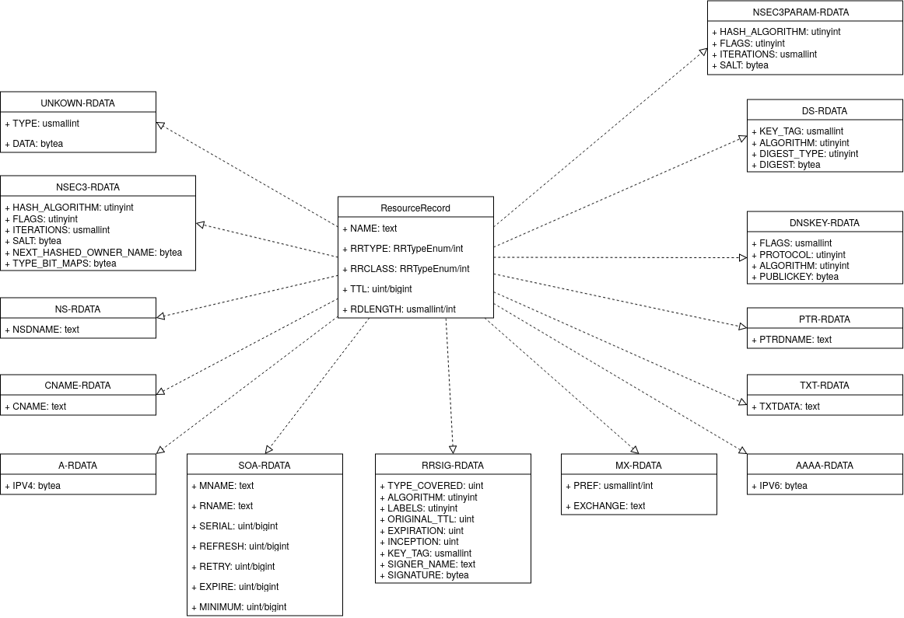
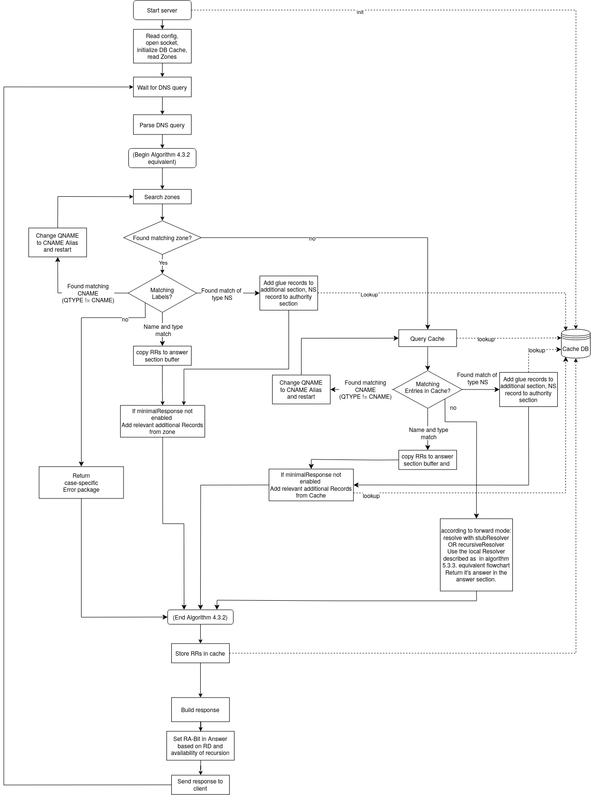
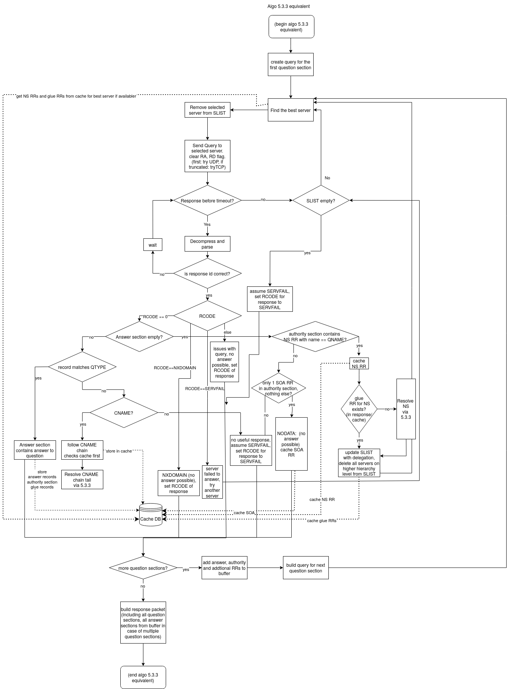

# Teamproject **Implementing a DNS server**

## Group members
### Group 1
- Hölz, Robin, 6979700, robin.hoelz@student.uni-tuebingen.de
- Müller, Viktor, 6349273, viktor.mueller@student.uni-tuebingen.de
- Philippin, Johannes, 6994772, johannes.philippin@student.uni-tuebingen.de
- Ruoff, Laurenz, 6978381, laurenz.ruoff@student.uni-tuebingen.de
- Bobes, Anas, 6688712, Anas.Bobes@student.uni-tuebingen.de
 
### Group 2
- Alnajar, Yaman, 5779680, yaman.alnajar@student.uni-tuebingen.de
- Baum, Kevin, 6386894, kevin.baum@student.uni-tuebingen.de
- Patnaik, Noemi, 6019008, noemi.patnaik@student.uni-tuebingen.de
- Zabel, Natalie, 6677093, natalie-aislyn.zabel@student.uni-tuebingen.de


## About
- Implements a DNS server with UDP and TCP support (Ipv4 and Ipv6 addresses work)
- Receives, parses, resolves, and serializes DNS packets using an object-oriented DNS message model
- Supports authoritative DNS zones loaded from BIND-style `named.conf` and zone files
- Supports common DNS record types including `A`, `AAAA`, `NS`, `MX`, `CNAME`, `SOA`, `PTR`, `TXT`, `DNSKEY`, `DS`, `RRSIG`, `NSEC`, `NSEC3`, `NSEC3PARAM`, and EDNS `OPT`
- Stores authoritative zone data and cached DNS records in PostgreSQL
- Resolves queries from local authoritative zones, cache, configured forwarders, or the built-in iterative recursive resolver
- Supports BIND-style forwarding configuration, including `forward only` and `forward first`
- Provides multiple upstream resolver strategies: failover, round-robin, random, and parallel
- Performs iterative recursive resolution with root hints, referrals, glue records, glueless delegation handling, CNAME following, and TCP fallback for truncated responses
- Supports EDNS, including configurable UDP payload size and DNSSEC OK (`DO`) handling
- Provides DNSSEC-aware responses by returning DNSSEC records such as `DNSKEY`, `DS`, `RRSIG`, and `NSEC` when requested
- Generates authoritative DNSSEC negative answers for local zones using `SOA`, `NSEC`, `RRSIG SOA`, and `RRSIG NSEC`
- Supports forwarding of negative DNSSEC answers from upstream resolving
- Correctly distinguishes between `NOERROR`, `NXDOMAIN`, `SERVFAIL`, and referrals
- Sets authoritative response flags for local zone answers and preserves non-authoritative behavior for upstream responses
- Includes fully configurable logging-section with `channel`, `category` and `severity`, according to the BIND-style
- Includes black-box integration tests, unit tests, code formatting and coverage reporting 
## Project Structure

```text
teamproject2026
├── AnsiColors.java
├── config
│  ├── Config.java
│  ├── ConfigManager.java
│  ├── interpreter
│  │  ├── ConfInterpreter.java
│  │  ├── ConfLexer.java
│  │  ├── ConfNode.java
│  │  ├── ConfParser.java
│  │  ├── ConfToken.java
│  │  └── ConfTokenType.java
│  ├── logging
│  │  ├── LoggingCategory.java
│  │  ├── LoggingCategoryType.java
│  │  ├── LoggingChannel.java
│  │  ├── LoggingSection.java
│  │  └── LoggingSeverity.java
│  ├── options
│  │  ├── OptionSection.java
│  │  └── ResolverSection.java
│  └── zones
│     ├── ZoneSection.java
│     └── ZoneType.java
├── data
│  └── MockResponses.java
├── database
│  ├── CacheHandler.java
│  ├── DatabaseConnectionProvider.java
│  └── ZoneHandler.java
├── DNS_SERVER.java
├── DNSParser.java
├── DNSZone.java
├── logging
│  ├── DNSEvent.java
│  ├── DNSEventType.java
│  ├── Logger.java
│  └── ResponseSource.java
├── model
│  ├── DNSPacket.java
│  ├── OpCode.java
│  ├── OPTPseudoResourceRecord.java
│  ├── QuestionSection.java
│  ├── RCode.java
│  ├── rdata
│  │  ├── RData.java
│  │  ├── RDataA.java
│  │  ├── RDataAAAA.java
│  │  ├── RDataCNAME.java
│  │  ├── RDataDNSKEY.java
│  │  ├── RDataDS.java
│  │  ├── RDataMX.java
│  │  ├── RDataNS.java
│  │  ├── RDataNSEC.java
│  │  ├── RDataNSEC3.java
│  │  ├── RDataNSEC3PARAM.java
│  │  ├── RDataOPTOption.java
│  │  ├── RDataPTR.java
│  │  ├── RDataRRSIG.java
│  │  ├── RDataSOA.java
│  │  ├── RDataTXT.java
│  │  └── RDataUnknown.java
│  ├── ResourceRecord.java
│  ├── RRClass.java
│  └── RRType.java
├── resolver
│  ├── AbstractResolver.java
│  ├── ForwardMode.java
│  ├── NameServer.java
│  ├── RecursiveResolver.java
│  ├── ReferralAnalyzer.java
│  ├── SListWrapper.java
│  ├── StubResolver.java
│  └── StubResolverStrategy.java
├── server
│  ├── AbstractServer.java
│  ├── DNSPayload.java
│  ├── DNSResolutionPipeline.java
│  ├── DNSResponseBuilder.java
│  ├── ServerContext.java
│  ├── TCPServer.java
│  └── UDPServer.java
└── zones
  ├── ZoneLexer.java
  ├── ZoneManager.java
  ├── ZoneParser.java
  ├── ZoneToken.java
  └── ZoneTokenType.java
```

### Package Overview

| Package / Class      | Purpose                                                                                                                                                                                                                                          |
|----------------------|--------------------------------------------------------------------------------------------------------------------------------------------------------------------------------------------------------------------------------------------------|
| `config`             | Loads and represents server configuration, including command-line and `named.conf` based settings.                                                                                                                                               |
| `config.interpreter` | Lexer, parser, token, and AST infrastructure for interpreting BIND-style `named.conf` files.                                                                                                                                                     |
| `config.logging`     | Logging configuration models, including categories, channels, and severity levels.                                                                                                                                                               |
| `config.options`     | Runtime option models for server and resolver behavior, including `EDNS` size and `DNSSEC` enable.                                                                                                                                               
| `config.zones`       | Configuration models for authoritative zone declarations and zone types.                                                                                                                                                                         |
| `data`               | Static mock DNS response data used by development utilities and during the early stages.                                                                                                                                                         |
| `database`           | PostgreSQL access layer for authoritative zone storage and DNS cache management. Includes `CacheHandler`, `ZoneHandler`, and database connection handling.                                                                                       |
| `logging`            | Structured DNS event logging, event types, response-source tracking, and logger implementation.                                                                                                                                                  |
| `model`              | Core DNS protocol model, including packets, questions, resource records, opcodes, response codes, classes, types, and EDNS OPT records.                                                                                                          |
| `model.rdata`        | RDATA implementations for supported DNS record types, including `A`, `AAAA`, `NS`, `MX`, `CNAME`, `SOA`, `PTR`, `TXT`, `DNSKEY`, `DS`, `RRSIG`, `NSEC`, `NSEC3`, `NSEC3PARAM`, `OPT`, and unknown record data.                                   |
| `resolver`           | Stub and iterative recursive resolver implementation. Handles forwarding, upstream resolver strategies, root-hint based recursion, referrals, glue and glueless delegation handling, CNAME chains, NODATA, NXDOMAIN, and TCP fallback.           |
| `server`             | UDP/TCP server implementation and query-resolution pipeline. Coordinates authoritative zone lookup, cache lookup, upstream resolution, response construction, response flags, RCODE handling, minimal responses, and DNSSEC-aware local answers. |
| `zones`              | BIND-style zone-file lexer, parser, token definitions, and zone loading support. Handles `$ORIGIN`, `$TTL`, `$INCLUDE`, comments, multiline records, escaped labels, and TXT strings.                                                            |
| `DNS_SERVER`         | Main entry point. Initializes configuration, logging, database connections, zone loading, cache, resolvers, and UDP/TCP servers.                                                                                                                 |
| `DNSParser`          | Low-level DNS parsing and serialization utilities for names, labels, wire-format data, flags, and byte conversions.                                                                                                                              |
| `DNSZone`            | In-memory representation of a parsed authoritative zone, including origin, default TTL, SOA validation, and resource records.                                                                                                                    | 
### Cache Structure
Both the Zones and the Cache internally use a PostgreSQL Database, that consists of two ResourceRecord Tables, one for the Zones and one for the Cache, and several RData Tables that inherit the ResourceRecord table, as can be seen in the following Graph: 

To increase type safety of the Database, we assign each field a type, some of which are userdefined.  
These are: 
- **RRTypeEnum**: An enumeration of all supported RR types
- **RRClassData**: An enumeration of RR Classes, only consists of the IN-Class
- **uint**: an unsinged 32-bit integer, internally uses a 64-bit integer restricted to its positive values
- **usmallint**: an unsinged 16-bit integer
- **utinyint**: an unsinged 8-bit integer

### Functionality Flowchart
The Server roughly follows the base Algorithms provided in [RFC1034](https://datatracker.ietf.org/doc/html/rfc1034) Section 4.3.2 and 5.3.3, however it differs in parts. 
For example, this Server does not implement the optional functionality of the RD-Bit and only forwards a query, if the [forwarding mode](#forwarding-mode) is configured accordingly, regardless of wether the RD-Bit is set or not.  
Generally, the resolution pipeline for this server is described by the following flowchart:   

Furthermore, the specific algorithm used to recursively resolve packages is documented below: 


## Requirements

- Java 25
- Docker CLI tools (including Docker Compose) or Docker Desktop

## How to start

1. Compile and package the project with 
```bash
mvn clean package
```

2. Start the PostgreSQL server using either
```bash
docker compose up -d
``` 
or use Docker Desktop, or generate an equivalent `docker run` command from `compose.yaml` using  [this](https://www.decomposerize.com/)  website. <br><br>
If there were changes to the database scheme since you last started the server, remove them so the init scripts can rerun:
```bash
docker compose down -v
```
 
### Unix
Start the DNS server from the project root with
```bash
java -jar target/dns-server.jar
```

Alternatively, add an alias of your choice
```bash
alias run='java -jar target/dns-server.jar'
```
You can then start the server using the alias and optionally pass command-line parameters:
```bash
run -p 2222
```

If there are issues with loading the dependencies, you can also use maven to execute the Server:
```bash
mvn exec:java -Dexec.mainClass="io.gitlab.teamproject2026.DNS_SERVER" -Dexec.args="<Arguments>"
```
### Windows
Start the DNS server from the project root with
```bash
java -jar target\dns-server.jar
```

Alternatively, add a function shortcut 
```PowerShell
function run { java -jar target\dns-server.jar }
```

You can then start the server using the shortcut and optionally pass command-line parameters:
```PowerShell
run -p 2222
```

## Testing

The current project is tested using both black-box tests executed via a Bash script and unit tests.

### Unit tests

Run the unit tests with
```bash
mvn test
```
make sure do have an instance of `postgresql` running (e.g. via docker). The server will remind you.

If there are issues with the database tests, try shutting down the database (via `docker compose down -v`) and then restarting it. Use the same fix if the DNS cache ever gets corrupted.

### Black-box testing

The CI will run the script test_server.sh. This script contains some black-box tests for the DNS server. 

The test file can also be ran locally. This is usefull for testing a bunch of different queries at once
```bash
./test_server.sh
```
Again, make sure to have an instance of `postgressql` running.

The test file contains many different versions of `dig` queries. 
- Regular lookups test the correctness of `DNS` queries
- Domains which often change addresses or are managed by cloudflare should only be checked on having no errors 
- `NXDOMAIN` lookups test the server ability to handle errors

Some queries take randomly longer in the CI. This is very likely due to internal delays at gitlabs `postgres` server. We have thus disabled pipelines failing when a query takes longer then expected. Just retry the pipeline a few times and you shall see, that this is not an issue of the `DNS` server.


### Examples on manual tests for the current state of the project

To test packet parsing and hexdump generation: 
- go into `io.gitlab.teamproject2026.server.AbstractServer:handleQuery` and uncomment the packet logging
- run `dig @127.0.0.1 uni-tuebingen.de AAAA`

To test supported DNS record types:
- `dig @127.0.0.1 uni-tuebingen.de A`
- `dig @127.0.0.1 uni-tuebingen.de AAAA`
- `dig @127.0.0.1 uni-tuebingen.de CNAME`
- `dig @127.0.0.1 uni-tuebingen.de SOA`
- `dig @127.0.0.1 uni-tuebingen.de TXT`
- `dig @127.0.0.1 uni-tuebingen.de NS`
- `dig @127.0.0.1 uni-tuebingen.de PTR`
- `dig @127.0.0.1 uni-tuebingen.de MX`
- `dig @127.0.0.1 cloudflare.com DNSSKEY`
- `dig @127.0.0.1 cloudflare.com RRSIG`
- `dig @127.0.0.1 cloudflare.com NSEC`
- `dig @127.0.0.1 cloudflare.com DS`

To test `DNSSEC` do function:
- `dig @127.0.0.1 cloudflare.com A +dnssec`
- `dig @127.0.0.1 none.existant.cloudflare.com A +dnssec`

The first query should contain `RRSIG` signatures in the answer section.
The second query should contain `NSEC` proofs of non-existence in the authority section.


### Monitoring

Along with the database, the `compose.yaml` file also starts a GUI for the database. This GUI can be accessed [here](http://localhost:8080). To log in you must select PostgreSQL as the database server type. 

Use the following credentials to log in:

| Setting  | Value     |
|----------|-----------|
| Username | postgres  |
| Password | example   |
| Database | dns       |

# Configuration parameters

## Command line
The parameter `-p` is used in the command line to specify a custom port. 
```bash
java -jar target/dns-server.java -p 2222
```

The parameter `--ipv4` is used to specify a custom IPv4 address (alternatives: `-a`, `-4`, `--listen-on`).
```bash
java -jar target/dns-server.java --ipv4 "0.0.0.0"
```

The parameter `--ipv6` is used to specify a custom IPv6 address (alternatives: `-6`, `--listen-on-6`).
```bash
java -jar target/dns-server.java --ipv4 "::1"
```

The parameter `--verbose` or `-v` sets the logging severity to `DEBUG`, enabling all logging of all possible messages.
```bash
java -jar target/dns-server.java --verbose 
```

The parameter `--quiet` or `-q` sets the logging severity to `ERROR`, enabling all only logging of error related messages.
```bash
java -jar target/dns-server.java --quiet 
```

The parameter `--silent` is used to disable a almost all server messages. 
```bash
java -jar target/dns-server.java --silent
``` 

The parameter `--log-level` + `{CRITICAL, ERROR, NOTICE, INFO, DEBUG}` is used to set a specific log level. The CI uses `NOTICE` by default, which minimizes logging.
```bash
java -jar target/dns-server.java --log-level NOTICE
``` 

The parameter `--minimal-responses` is used to disable glue data for `NS` and `MX` records. This option exists in `BIND` and can increase performance. It is used by the CI aswell.
```bash
java -jar target/dns-server.java --minimal-responses
``` 

## DNS server config file (`named.conf`)
The DNS server supports a BIND-style configuration file called `named.conf`.


The file called `named.conf` in the server’s working directory, can be used to configure default server settings such as the listening address, port, and zone definitions. Command-line arguments take precedence over values defined in the configuration file.
Example config;

```aiignore
# DNS server configuration
# These values are overridden by command-line arguments if provided.
options {
    directory "zones";
    listen-on port 2222 {127.0.0.1; };
};
```
This configuration instructs the server to listen on 127.0.0.1:2222 and to use the zones directory as the default location for zone files.

The primary purpose of `named.conf` is to declare DNS zones that should be loaded when the server starts.

```aiignore
options {
    directory "zones";
    listen-on port 2222 {127.0.0.1; };
    listen-on-v6 { none; };
};

zone "example.com" {
    type primary;
    file "db.example.com";
};

zone "0.0.129.in-addr-arpa" {
    type primary;
    file "db.129.0.0";
};
```

Two top-level declarations are supported:

- options – server-wide configuration settings
- zone – DNS zone definitions

A zone declaration specifies:

1. The zone origin (for example `"example.com"`)
2. The zone type
3. The zone file to load

The zone types primary and master are treated as equivalent and indicate that this server is authoritative for the zone.

The types secondary and slave indicate that the zone is managed by another server and would normally be synchronized through DNS zone transfers. Since this project does not implement zone transfers, only primary zones should be used.


The file directive specifies the zone file that should be loaded. If the file path is relative (does not begin with `'/'`), it is resolved relative to the directory specified by the directory option.


For example:
```aiignore
options {
    directory "zones";
};

zone "example.com" {
    type primary;
    file "db.example.com";
};
```

causes the server to load:
```aiignore
zones/db.example.com
```

## DNS Zone Files

Zone data is stored in standard BIND-style zone files. Each zone declared in named.conf references a zone file containing the resource records for that zone.

Example:
```dns
$ORIGIN example.com. 
$TTL 3600  

@ IN SOA ns1.example.com. admin.example.com. (
     2026051201     
     3600     
     1800     
     1209600     
     3600 
)  

@       IN NS     ns1.example.com. 
ns1     IN A      192.0.2.53 
www     IN A      192.0.2.1 
mail    IN A      192.0.2.2  
@       IN MX     10 mail.example.com. 
@       IN TXT    "Example DNS zone"
```


### Supported Directives

#### $ORIGIN

Sets the current zone origin. Relative domain names are automatically expanded using the active origin.

Example:

```dns
$ORIGIN example.com.  www IN A 192.0.2.1
```

is interpreted as:

```dns
www.example.com. IN A 192.0.2.1
```

---

#### $TTL

Defines the default TTL (Time To Live) used by records that do not explicitly specify a TTL.

Example:

```dns
$TTL 3600  www IN A 192.0.2.1
```


The record will receive a TTL of 3600 seconds.

TTL values may also use DNS duration suffixes:

| Suffix | Meaning |
|--------|---------|
| s      | seconds |
| m      | minutes |
| h      | hours   |
| d      | days    |
| w      | weeks   |

Example:
```dns
$TTL 1h  
www 30m IN A 192.0.2.1
```

---

#### $INCLUDE

Includes another zone file at the current location.

Example:

```dns
$ORIGIN example.com.
@ IN SOA ns1.example.com. admin.example.com. (
     2026051201     
     3600     
     1800     
     1209600     
     3600 
)  
@ IN NS ns1.example.com.  

$INCLUDE "subdomain.zone"  optional.new.origin

www IN A 192.0.2.1
```

If subdomain.zone contains:
```dns
api  IN A 192.0.2.10 
mail IN A 192.0.2.20
```

The parser behaves as if the included records were inserted directly at the location of the `$INCLUDE` directive.

Included files inherit the currently active `$ORIGIN` and `$TTL` values unless an optional new origin is provided. If a new origin is specified, it is used only while parsing the included file. After the include has been processed, the parent zone file continues using its original origin.

If no `$ORIGIN` directive exists in the zone file, the origin specified in `named.conf` is used.

Relative include paths are resolved relative to the zone directory configured in `named.conf`.

#### Restrictions

A zone must contain exactly one SOA record.

Included files must therefore not introduce an additional SOA record. Loading a zone that contains multiple SOA records will fail validation.

### Comments

Comments begin with a semicolon (`;`) and continue until the end of the line.

Example:

```dns
www IN A 192.0.2.1 ; Web server
```

### Multiline Records

Parentheses may be used to split records across multiple lines.

This is commonly used for SOA records and large TXT records.

Example:

```dns
@ IN SOA ns1.example.com. admin.example.com. (
     2026051201     
     3600     
     1800     
     1209600     
     3600 
)
```

TXT records may also span multiple quoted strings:

```dns
multitxt IN TXT (
     "This text "     
     "spans multiple "     
     "strings" 
)
```

### Escaping Special Characters

Domain labels and TXT strings support DNS escape sequences.

Examples:
```dns
foo\.bar      IN A   192.0.2.1 
literal\@     IN TXT "hello" 
space\ label  IN TXT "world"
```

Decimal escape sequences are also supported:
```dns
hello\032world IN TXT "example"
foo\046bar     IN A   192.0.2.1
```

which correspond to:

```text
\032 = space 
\046 = . 
\064 = @ 
\092 = \
```


## Resolver Configuration
The resolver can be configured in the `options` section of `named.conf`.

If a setting is not specified, a built-in default value is used.

Example configuration:

```conf
options {
    # Upstream DNS servers used for forwarding queries
    forwarders {
        8.8.8.8;
        1.1.1.1;
    };

    # Forwarding mode
    forward only;

    # Resolver tuning options
    resolver {
        timeout 2000;
        max-retries 2;
        retry-delay 100;
        strategy failover;
    };
};
```

### Forwarders

The forwarders section defines one or more upstream DNS servers to which queries are forwarded, if an eligible forwarding mode is used.

```conf
forwarders {
    8.8.8.8;
    1.1.1.1;
};
```
If no forwarders are configured, the default servers are used.

### Forwarding mode

The forward directive controls how queries are resolved.

```conf
forward only;
```

- only - Queries are sent exclusively to the configured forwarders.
- first - Queries are sent to the configured forwarders first. If all forwarders fail, the server performs resolution itself.

If no such line exists in the config, the server always performs resolution itself (this is `BIND` behaviour).

### Resolver options

The optional resolver section controls internal resolver behavior.

```conf
resolver {
    timeout 2000;
    max-retries 2;
    retry-delay 100;
    strategy failover;
};
```

#### timeout

Specifies the timeout for a forwarded query in milliseconds.

```conf
timeout 2000;
```

#### max-retries

Specifies the maximum number of retry attempts before a query is considered failed.

```conf
max-retries 2;
```

#### retry-delay

Specifies the delay between retry attempts in milliseconds.

```conf
retry-delay 100;
```

#### strategy

Specifies how upstream servers are selected.

Supported values:

- `failover` - Try forwarders in the order they are configured until one responds.
- `round-robin` - Rotate through the configured forwarders.
- `random` - Select a random forwarder for each query.
- `parallel` - Query all forwarders simultaneously and use the first response.

## Database config files
You can change the configuration of the PostgreSQL server both in the `compose.yaml` and the `postgres/postgres.conf` files.  
- `compose.yaml` determines how the Docker container is created and initialized. For example, it configures the container such that, the `postgres.conf`  file is mounted in the container to `/etc/postgresql/postgresql.conf` directory and used as the main config file for the PostgreSQL server. 
- `postgres.conf` is the config file for the PostgreSQL server itself

Finally, you can configure the initial state of the database by mounting scripts to the `/docker-entrypoint-initdb.d/` directory within the container, as any `.sql` or `.sh` scripts will automatically be executed on container startup. 

## DNS Extensions 
The server supports:
- `EDNS`, allowing for custom `UDP-sizes` and other goodies such as `dnssec-do` to request `DNSSEC` aware answers.
- `DNSSEC` awareness, allowing for querying and parsing `DNSSEC` records and generating correct `DNSSEC` answers from local zones. `DNSSEC` answers from upstream are forwarded aswell. Validation of `DNSSEC` is not supported.
- `SPF`, by adding a `SPF` TXT-Record in one of the local zones

## Known issues and bugs
- None

# Changelog
```diff
~ edns
~ resolver
~ config/
~ zones/
~ DNSZone
~ DNS_SERVER
~ README.md
```